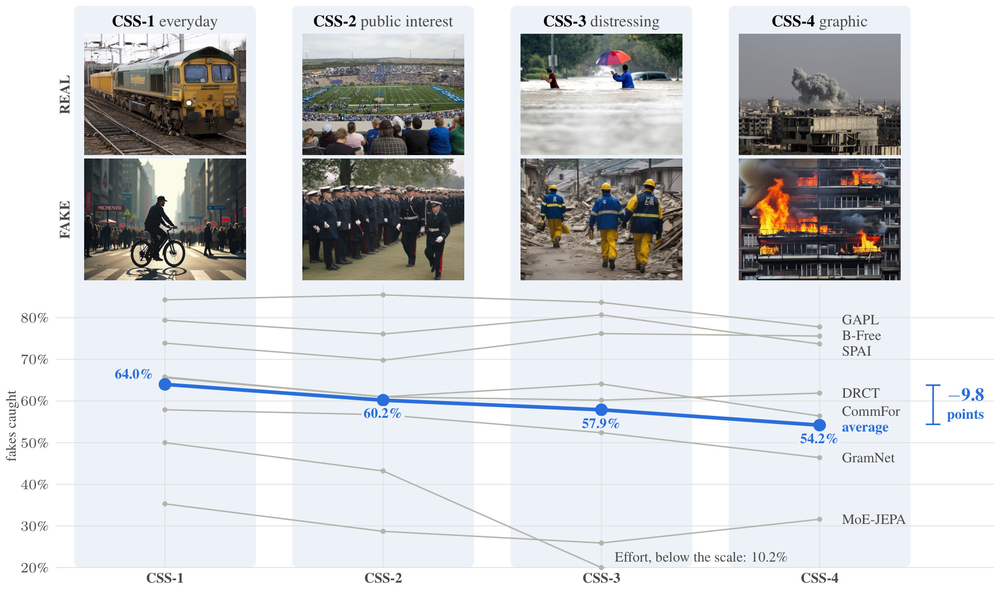
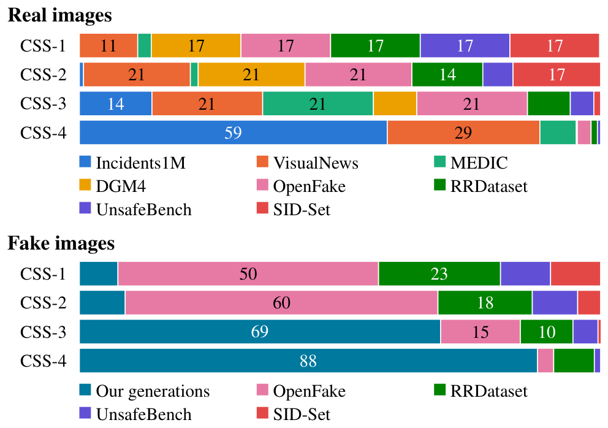
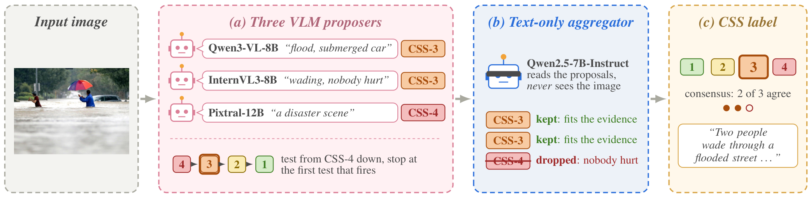

# GREVE: dataset construction and CSS annotation code

<p align="center"></p>

<p align="center"><em>One real and one fake image per CSS level. Below: the share of fakes caught at each level by 8 of the detectors in Table 1. The average (blue) drops by 9.8 points from CSS-1 to CSS-4.</em></p>

GREVE is a benchmark of **real photographs vs. fully synthetic images** in which every image carries a **Content Sensitivity Score (CSS)**:

- **CSS-1:** everyday content;
- **CSS-2:** public-interest content;
- **CSS-3:** distressing content;
- **CSS-4:** graphic or catastrophic content.

Detector accuracy is reported per CSS level.

This repository contains the code that built and annotated the dataset:

1. **collection** of real and fake candidate pools from 8 public datasets;
2. **CSS annotation** with three VLM proposers, a text-only LLM aggregator and code guards;
3. **generation** of extra CSS-3/4 fakes with 14 open text-to-image models;
4. **curation**: deduplication, balanced selection, JPEG release and train/val/test split;
5. **release**: the full manifest, and a script that rebuilds the dataset from the original images.

## Contents
- [Dataset at a glance](#dataset-at-a-glance)
- [Benchmark results](#benchmark-results)
- [Data release](#data-release)
- [Replicating the dataset](#replicating-the-dataset)
- [Pipeline overview](#pipeline-overview)
- [Repository layout](#repository-layout)
- [Installation](#installation)
- [The CSS annotation](#the-css-annotation)
- [Reproducing the dataset step by step](#reproducing-the-dataset-step-by-step)
- [Design choices and safeguards](#design-choices-and-safeguards)
- [Source datasets and licenses](#source-datasets-and-licenses)

---

## Dataset at a glance

The dataset has 78,000 images, all JPEG, with real = fake in every cell.

| | CSS-1 | CSS-2 | CSS-3 | CSS-4 |
|---|---|---|---|---|
| real | 12,000 | 12,000 | 12,000 | 3,000 |
| fake | 12,000 | 12,000 | 12,000 | 3,000 |

<p align="center"></p>

<p align="center"><em>Image sources per CSS level (% of the cell). Most CSS-3/4 fakes are our own generations.</em></p>

## Benchmark results

We evaluate 25 AI-generated-image detectors and 7 VLMs on GREVE. For each CSS level the table reports accuracy on real (R) and on fake (F) images. Acc and mAUC are the means of the four level accuracies and of the four level AUCs. caAcc and caAUC are content-aware metrics that weight the levels by sensitivity. Models are sorted by caAcc; the best overall value is in **bold** and the second best is <ins>underlined</ins>. The evaluation code will be in [`benchmark/`](benchmark/).

<details open>
<summary><b>Table 1.</b> Per-level results of 25 detectors and 7 VLMs (%).</summary>

| Model | Venue | CSS-1 R | CSS-1 F | CSS-2 R | CSS-2 F | CSS-3 R | CSS-3 F | CSS-4 R | CSS-4 F | Acc | mAUC | caAcc | caAUC |
|---|---|---:|---:|---:|---:|---:|---:|---:|---:|---:|---:|---:|---:|
| ***Detectors*** | | | | | | | | | | | | | |
| GAPL | CVPR 2026 | 81.9 | 84.3 | 84.6 | 85.5 | 85.6 | 83.7 | 82.3 | 77.8 | **83.2** | <ins>91.2</ins> | **82.2** | <ins>90.2</ins> |
| B-Free | CVPR 2025 | 90.7 | 73.9 | 94.7 | 69.8 | 89.7 | 76.2 | 80.4 | 75.6 | <ins>81.4</ins> | 86.9 | <ins>80.2</ins> | 86.0 |
| CommFor | CVPR 2025 | 98.2 | 65.6 | 98.8 | 61.0 | 99.0 | 64.1 | 98.9 | 56.4 | 80.2 | **93.8** | 79.3 | **93.3** |
| SPAI | CVPR 2025 | 72.7 | 79.4 | 75.4 | 76.1 | 78.8 | 80.7 | 82.6 | 73.7 | 77.4 | 85.1 | 78.1 | 86.0 |
| DRCT | ICML 2024 | 89.9 | 65.8 | 92.7 | 61.0 | 91.7 | 60.2 | 78.6 | 61.9 | 75.2 | 84.7 | 73.2 | 82.6 |
| GramNet | CVPR 2020 | 67.6 | 57.9 | 74.9 | 56.7 | 83.5 | 52.4 | 89.5 | 46.4 | 66.1 | 75.5 | 67.3 | 79.2 |
| MoE-JEPA | ECCVW 2026 | 98.3 | 35.3 | 99.0 | 28.7 | 99.8 | 25.9 | 99.8 | 31.6 | 64.8 | 80.9 | 64.7 | 83.8 |
| NPR | CVPR 2024 | 75.0 | 32.0 | 83.0 | 29.6 | 88.3 | 25.5 | 93.4 | 26.7 | 56.7 | 63.0 | 58.2 | 65.8 |
| Effort | ICML 2025 | 88.6 | 50.0 | 94.9 | 43.2 | 96.0 | 20.0 | 95.9 | 10.2 | 62.4 | 76.7 | 57.8 | 72.2 |
| CLIPDet | CVPRW 2024 | 71.0 | 42.0 | 85.6 | 22.9 | 84.2 | 25.6 | 74.2 | 38.6 | 55.5 | 64.3 | 55.7 | 63.7 |
| LGrad | CVPR 2023 | 81.2 | 28.1 | 87.1 | 22.9 | 92.1 | 19.8 | 93.4 | 13.7 | 54.8 | 59.6 | 54.5 | 60.3 |
| C2P-CLIP | AAAI 2025 | 98.1 | 12.4 | 99.5 | 7.0 | 99.5 | 3.7 | 99.8 | 1.9 | 52.7 | 59.5 | 51.7 | 57.3 |
| PatchCraft | arXiv 2023 | 75.8 | 31.7 | 80.5 | 33.1 | 77.1 | 29.1 | 76.6 | 21.6 | 53.2 | 58.4 | 51.6 | 55.6 |
| LNP | ECCV 2022 | 92.2 | 7.5 | 94.9 | 9.3 | 94.8 | 9.5 | 95.9 | 6.3 | 51.3 | 65.2 | 51.5 | 66.0 |
| CNNSpot | CVPR 2020 | 96.0 | 2.8 | 98.7 | 1.9 | 97.6 | 5.2 | 97.6 | 5.7 | 50.7 | 50.3 | 51.2 | 53.6 |
| PGC | ICML 2026 | 99.2 | 2.3 | 99.8 | 1.4 | 99.5 | 1.5 | 98.9 | 4.1 | 50.8 | 72.7 | 51.0 | 70.8 |
| SAFE | KDD 2025 | 96.2 | 0.7 | 97.2 | 0.7 | 98.8 | 0.8 | 98.2 | 5.2 | 49.7 | 46.7 | 50.6 | 50.3 |
| RINE | ECCV 2024 | 97.6 | 7.1 | 98.9 | 6.6 | 97.7 | 4.4 | 95.7 | 2.8 | 51.3 | 65.3 | 50.4 | 64.1 |
| FatFormer | CVPR 2024 | 95.7 | 6.0 | 98.3 | 4.3 | 98.8 | 2.1 | 98.5 | 1.2 | 50.6 | 53.6 | 50.3 | 54.5 |
| DGS-Net | ICML 2026 | 97.4 | 4.0 | 98.5 | 3.2 | 99.5 | 0.8 | 99.0 | 0.4 | 50.3 | 57.9 | 50.0 | 57.3 |
| UnivFD | CVPR 2023 | 97.9 | 1.8 | 99.4 | 1.7 | 99.5 | 0.8 | 99.3 | 0.2 | 50.1 | 51.0 | 50.0 | 51.6 |
| DIRE | ICCV 2023 | 4.3 | 97.4 | 2.0 | 97.7 | 1.3 | 97.9 | 1.9 | 98.4 | 50.1 | 49.7 | 50.0 | 48.5 |
| Fusing | ICIP 2022 | 98.7 | 0.5 | 99.6 | 0.3 | 99.5 | 0.3 | 99.7 | 0.4 | 49.9 | 51.2 | 50.0 | 47.6 |
| AIDE | ICLR 2025 | 95.9 | 2.1 | 98.3 | 1.8 | 99.2 | 0.9 | 99.4 | 0.5 | 49.8 | 53.0 | 49.9 | 52.2 |
| FreDect | ICML 2020 | 82.3 | 13.8 | 87.1 | 12.2 | 88.0 | 10.3 | 88.3 | 6.4 | 48.5 | 41.4 | 48.2 | 37.8 |
| ***Vision-language models*** | | | | | | | | | | | | | |
| Qwen3-VL-8B |  | 89.8 | 53.0 | 94.7 | 55.3 | 96.2 | 49.4 | 96.1 | 68.5 | **75.4** | <ins>81.5</ins> | **78.0** | **83.0** |
| Qwen3-VL-30B-A3B |  | 93.9 | 47.8 | 97.0 | 46.0 | 97.9 | 43.2 | 98.3 | 54.1 | <ins>72.3</ins> | **82.4** | <ins>73.7</ins> | **83.0** |
| Qwen2.5-VL-32B |  | 88.2 | 44.4 | 93.9 | 40.0 | 95.1 | 30.1 | 94.6 | 37.1 | 65.4 | 74.7 | 65.2 | <ins>73.6</ins> |
| InternVL3.5-30B-A3B |  | 76.2 | 46.5 | 89.4 | 33.1 | 90.6 | 25.1 | 83.2 | 52.9 | 62.1 | 71.7 | 63.9 | 73.4 |
| InternVL3-8B |  | 81.5 | 38.6 | 91.8 | 29.6 | 94.4 | 14.3 | 90.9 | 26.6 | 58.5 | 67.0 | 57.9 | 67.2 |
| Qwen2.5-VL-7B |  | 94.2 | 19.5 | 97.4 | 15.9 | 98.4 | 8.3 | 98.0 | 17.4 | 56.1 | 71.0 | 56.3 | 70.2 |
| Kimi-VL-A3B |  | 87.0 | 21.2 | 93.7 | 17.6 | 93.7 | 6.5 | 85.6 | 7.2 | 51.6 | 47.6 | 49.2 | 42.6 |

</details>

## Data release

We release:
1. **The manifest**, in [`manifest/`](manifest/): one gzipped JSON list per split, 78,000 entries in total. For every image it records:
   - where the image comes from: source dataset, the source's own id and split, and the original file name;
   - its label, CSS level and split;
   - every model answer behind the CSS (the three proposers, the aggregator and the guards);
   - a pixel hash that lets anyone check that a downloaded image is the right one.

   All fields are described in [docs/manifest_fields.md](docs/manifest_fields.md).
2. **Our 12,893 generated images** (`source_dataset == "cssgen"`), which will be released on Hugging Face (⚠️ link coming soon).

**We do not redistribute the other 65,107 images.** They belong to their source datasets, which keep their own licenses and access conditions. Anyone can rebuild the full dataset by downloading them from the original sources, as described below.

```python
import gzip, json
entries = [e for s in ("train", "val", "test")
           for e in json.load(gzip.open(f"manifest/greve_manifest_{s}.json.gz", "rt"))]
e = entries[0]
e["image_id"], e["label"], e["css_score"], e["greve_split"], e["greve_path"]
```

## Replicating the dataset

**1. Get access to the source datasets** and accept their terms. Gated Hugging Face datasets need `HF_TOKEN`.

| `source_dataset` | Where to get it | How the manifest identifies the image |
|---|---|---|
| `openfake` | Hugging Face `ComplexDataLab/OpenFake` | `hf_repo`, `split`, `source_image_id` |
| `sidset` | Hugging Face `saberzl/SID_Set` | `hf_repo`, `split`, `source_image_id` |
| `dgm4` | Hugging Face `rshaojimmy/DGM4` (pristine images only) | `hf_repo`, `split`, `source_image_id` |
| `unsafebench` | Hugging Face `yiting/UnsafeBench` (gated) | `hf_repo`, `split`, `source_image_id` |
| `rrdataset` | Zenodo record 14963880 ("original" condition) | `split`, `source_image_id` |
| `visualnews` | VisualNews `origin.tar` (from its authors) | `source_image_id` |
| `medic` | MEDIC v1.0 (CrisisNLP) | `split`, `source_image_id` |
| `incidents` | Incidents1M (label files on request from the authors; images are downloaded from their URLs) | `split`, `source_image_id` |
| `cssgen` | our Hugging Face release (coming soon) | `image_id` |

**2. Download the original files** into `$GREVE_IMAGES_DIR`, named as in the manifest's `filename` field. The extractors in [`greve/collect/`](greve/collect/) (see step 1 below) download each source and save every file under exactly that name. The manifest lists which of those images are part of GREVE. An image that an extractor's candidate pool does not contain can be fetched directly from its source using the identifiers in the table.

**3. Rebuild the release:**

```bash
python -m greve.release.rebuild_from_manifest --manifest manifest/greve_manifest_*.json.gz \
    --originals_dir $GREVE_IMAGES_DIR --out data/GREVE
```

The script first checks every original against its `pixel_sha256`, so a wrong or re-compressed download is caught. It then writes `<out>/<greve_path>`:
- original JPEGs are copied byte for byte;
- every other image is re-encoded exactly as in our build, at the JPEG quality recorded in `greve_jpeg_q`.

On our data, the rebuilt files are byte-identical to the released ones. Missing or mismatching originals (for example, Incidents1M URLs that have since gone offline) are listed in `<out>/rebuild_report.json`.

## The CSS annotation

<p align="center"></p>

<p align="center"><em>(a) Three VLMs score the image with an ordered rubric, testing from CSS-4 down. (b) A text-only LLM reads their answers, never the image, and keeps the proposals the evidence supports. (c) Code guards then fix the final CSS label.</em></p>

Full details are in [docs/annotation.md](docs/annotation.md).

**Rubric.** The rubric is an ordered decision procedure. Test 4 (graphic/catastrophic) is checked first, then Test 3 (distressing), then Test 2 (public interest), and the first test that fires sets the level. The score describes the **content only**: the models are told to score every image as if it were an authentic photograph and never to judge authenticity. Edge rules cover:
- artwork and staged or fictional content (at most CSS-2);
- film, TV and game covers (at most CSS-3);
- combat sports (sport, not violence);
- weapons, medical scenes and animals.

**Annotation stages:**
1. **Three proposers:** Qwen3-VL-8B-Instruct, InternVL3-8B and Pixtral-12B. Each sees the image and the rubric and answers in JSON: scene description, the test that fired and its evidence, score, confidence and flags. Decoding is greedy.
2. **Aggregator:** Qwen2.5-7B-Instruct, text only. It reads the three answers, checks the image context (photograph, artwork, cover, staged scene, combat sport…), checks the evidence the analysts cite against each other, and gives a final score.
3. **Code guards:** these keep the aggregator from overriding the proposers.
   - **Majority ceiling:** the final score never exceeds a 2-of-3 majority. When all three proposers disagree, it stays within their range.
   - **Context cap:** artwork at most 2, media cover at most 3.
   - **Fiction cap:** if at least 2 proposers flag `staged_or_fictional`, the score is at most 2.


## Reproducing the dataset step by step

The commands below are the ones used to build GREVE, in order. Every step can be resumed: re-running a command skips work that is already done. Multi-GPU runs use `--num_shards N --shard i` (one process per GPU) or the scripts in `scripts/`, which read the GPU ids from `GPUS="0 1 2 …"`.

### 1 · Collect candidate pools

Each extractor writes its images to `$GREVE_IMAGES_DIR`, keeps the original bytes, and records the entries in `metadata/manifest_<source>.json`. Grayscale images are dropped at this step.

```bash
# OpenFake (real LAION photos + fakes from many generators): index the parquet shards, select, download
python -m greve.collect.extract_openfake index
python -m greve.collect.extract_openfake select
python -m greve.collect.extract_openfake fetch
python -m greve.collect.extract_sidset                  # SID-Set: real (OpenImages) + full-synthetic FLUX; tampered never taken
python -m greve.collect.extract_rrdataset               # RRDataset, "original" condition only
python -m greve.collect.extract_dgm4                    # DGM4 pristine photos only (no manipulated images)
python -m greve.collect.extract_unsafebench             # UnsafeBench: LAION-5B reals + Lexica fakes
python -m greve.collect.extract_visualnews --n 15000    # caption-keyword mining of VisualNews
bash greve/collect/download_medic.sh && python -m greve.collect.extract_medic --n 12000
```

Sources used for the CSS-4 real side. These pools are screened before full annotation (step 2):

```bash
python -m greve.collect.extract_visualnews --all_remaining \
    --buckets attack_explosion graphic_violence mass_casualty unrest war_conflict weapons \
    --exclude_manifest metadata/manifest_visualnews.json \
    --metadata_path metadata/screen/manifest_visualnews_screen.json
python -m greve.collect.extract_incidents --labels data/raw/incidents/multi_label_train.json data/raw/incidents/multi_label_val.json
```

### 2 · Screen the large real pools for CSS-4

```bash
# Incidents1M: CLIP linear probe trained on the already-scored pools; keep the top 30%
python -m greve.screen.clip_rank probe metadata/manifest_*.json --gpu 0
python -m greve.screen.clip_rank select metadata/screen/manifest_incidents_screen.json \
    metadata/screen/manifest_incidents_top.json --probe data/cache/css4_probe.npz --keep_fraction 0.3 --gpu 0
# Qwen3-VL alone scores the screen pool; images it scores 4 then get the full annotation
GPUS="0 1 2 3 4 5 6" bash scripts/screen_pool.sh metadata/screen/manifest_incidents_top.json   metadata/manifest_incidents.json       incidents
GPUS="0 1 2 3 4 5 6" bash scripts/screen_pool.sh metadata/screen/manifest_visualnews_screen.json metadata/manifest_visualnews_extra.json vnextra
```

The screen uses the same prompt and model as the first proposer, and its answer is reused in the full annotation.

### 3 · Annotate

```bash
# every pool: three proposers, then the aggregator and guards
for m in metadata/manifest_*.json; do GPUS="0 1 2 3 4 5 6" bash scripts/score_pool.sh $m $(basename $m .json); done
# or the single steps, e.g.
python -m greve.annotate.proposer_qwen --manifest metadata/manifest_medic.json --gpu 0
python -m greve.annotate.aggregator   --manifest metadata/manifest_medic.json --gpu 0
```

Extra OpenFake fakes for the CSS-2/3 cells:

```bash
python -m greve.collect.select_openfake_extra --n 8000
python -m greve.collect.extract_openfake --selection_path metadata/openfake_selection_extra.parquet \
    fetch --metadata_path metadata/manifest_openfake_extra.json
GPUS="0 1 2 3 4 5 6" bash scripts/score_pool.sh metadata/manifest_openfake_extra.json ofextra
```

### 4 · Generate CSS-3/4 fakes

Public fake datasets contain few sensitive scenes, so CSS-3/4 fakes are generated text-to-image.

**Prompts.** Each prompt is a fixed documentary-photo prefix (`"Candid documentary news photograph, photojournalism, realistic, natural light. "`) followed by the scene description that a proposer wrote for a real CSS-3/4 image. The prompt also keeps that image's aspect ratio. The real image is never given to a generator, so every fake is fully synthetic. Scene descriptions are used instead of captions because captions name real people and events.

**Scoring.** Generated images are annotated exactly like every other image. Each one counts at the level it is scored at, not at the level its prompt targeted.

```bash
python -m greve.generate.gen_prompts --levels 3 4 --per_level 150 --out metadata/gen/pilot_prompts.jsonl   # pilot
python -m greve.generate.gen_prompts_full --out metadata/gen/full_prompts.jsonl                          # full run
python -m greve.generate.generate --model flux-dev --prompts metadata/gen/full_prompts.jsonl \
    --metadata_path metadata/gen/manifest_gen_full.json --gpu 0 [--num_shards N --shard i]
# ... one run per model (see MODELS in generate.py), then annotate the generated images:
GPUS="0 1 2 3 4 5 6" bash scripts/score_pool.sh metadata/gen/manifest_gen_full.json genfull
python -m greve.generate.topup_plan --status            # usable fakes per level under the source caps
python -m greve.generate.promote_cssgen                 # → metadata/manifest_cssgen.json
```

**Models:**
- FLUX.1-dev, FLUX.1-schnell and FLUX.1-Krea-dev;
- Chroma1-HD, Z-Image-Turbo, Lumina-Image-2.0, SANA-1.6B and PixArt-Σ;
- HunyuanDiT-v1.2, AuraFlow-v0.3 and Kandinsky-3;
- SDXL, Playground-v2.5 and Kolors.

CogView4 ran in the pilot only and was dropped. Sampling settings for every model are in `MODELS` in `greve/generate/generate.py`. The top-up loop (`topup_plan.py --wave N`) was ready but not needed: every fake level was already complete after the full run.

### 5 · Curate and release

```bash
python -m greve.curate.dedup_phash --workers 64         # → metadata/dedup/
python -m greve.curate.select_final                     # → metadata/final/css_v2_selection.json + selection_report.txt
python -m greve.curate.build_release --workers 48       # → $GREVE_RELEASE_DIR/CSS-x/{real,fake}/*.jpg + greve_manifest.json
python -m greve.curate.split_release                    # dry run; add --apply to move files into train/val/test
```

To rebuild the release from the published manifest instead of re-running steps 1–5, see [Replicating the dataset](#replicating-the-dataset).

## Design choices and safeguards

- **Only real photos and fully synthetic images.** Tampered or partially manipulated images are never collected: the extractors skip them for SID-Set and DGM4.
- **No content shortcut.** Generated fakes reuse the scene descriptions of real images at the same level. CSS-4 fakes are selected to match the real CSS-4 content mix, cue by cue (fire/explosion, blood/injury, …).
- **Source caps.** A single source fills at most 50% of a cell; OpenFake may fill up to 60% of CSS-2. Each of our generators counts as its own source.
- **Excluded on both sides:** grayscale images, near-duplicates, and images that at least 2 proposers flag `sexual_content`.
- **Format.** Every released image is a JPEG. Non-JPEG originals are re-encoded with a quality drawn from the real JPEGs of the same level (seeded by `image_id`). Original JPEG bytes are kept unchanged.
- **Safety in generation.**
  - CSS-4 harm prompts that described minors were rewritten to adults.
  - Chroma1-HD gets an extra anti-nudity negative prompt.
  - CogView4 was dropped because it softened harmful prompts.

## Source datasets and licenses

The code in this repository only downloads and processes data. Each source keeps its own license and terms of use, which users must accept:
- OpenFake (CC BY-NC 4.0);
- SID-Set;
- RRDataset (CC BY 4.0);
- DGM4;
- UnsafeBench (gated, Data Use Agreement);
- VisualNews;
- MEDIC (CC BY-NC-SA 4.0);
- Incidents1M (labels on request from the authors).

Generated images follow the licenses of the respective generator models.
